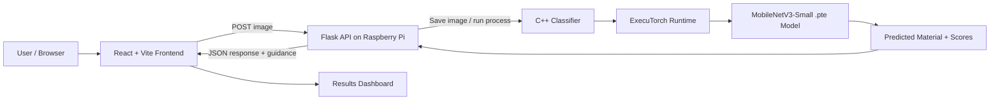

<!-- EcoSort AI README | Namma AI Hackathon -->
<div align="center">

# ♻️ EcoSort AI

### Smarter waste classification, powered at the edge.

An image-based waste material classification prototype that brings **AI inference to a Raspberry Pi**. Upload a waste image from the browser, run the trained model locally on the Pi, and view the predicted material with practical disposal guidance.


[Explore the repository](https://github.com/HarshJain2006/EcoSort-AI) · [Read the Technical Handoff](TECHNICAL_HANDOFF.md) · [View the latest commit](https://github.com/HarshJain2006/EcoSort-AI/commit/c2a4dc0c517377e81e432632c1d453e287c6bf73)

</div>

---

## 🌱 What is EcoSort AI?

EcoSort AI is an edge-AI prototype for classifying the **dominant material** visible in a waste image. The web interface is built with React and Vite. A Flask API runs on a Raspberry Pi and invokes a native C++ classifier using the ExecuTorch runtime and a trained MobileNetV3-Small model.

The goal is to demonstrate a practical path from image capture/upload to on-device inference without sending each image to a cloud inference service.

> **Prototype scope:** one image in, one dominant material category out. This version is a classifier—not an object detector, full-scene understanding system, or automated sorting actuator.

## ✨ What it can do

- **Upload and classify:** submit an image from the browser and request inference on the Raspberry Pi.
- **Edge inference:** execute the exported .pte model through a C++/ExecuTorch classifier on the Pi.
- **Nine material categories:** classify battery, cardboard, glass, metal, organic, paper, plastic, textile, or trash.
- **Material guidance:** show rule-based biodegradability and recyclability guidance where applicable.
- **Device status:** check whether the Pi backend and classifier are reachable.
- **Recent results:** retrieve up to 50 recent predictions held in the running Flask process.

## 🧭 How the system works



### Classification flow

1. The user selects an image in the web application.
2. The frontend uploads it to `/api/upload` and receives a `file_id`.
3. The frontend sends that ID to `/api/predict`.
4. Flask invokes the compiled C++ classifier on the Raspberry Pi.
5. The classifier loads the ExecuTorch model, preprocesses the image and returns class scores.
6. The API responds with the prediction, confidence and material guidance; the frontend displays the result.

## 🗂️ Supported material categories

| Model label | What it represents |
|---|---|
| `battery` | Batteries |
| `cardboard` | Cardboard and corrugated packaging |
| `glass` | Glass material |
| `metal` | Metal material |
| `organic` | Organic / food waste |
| `paper` | Paper material |
| `plastic` | Plastic material |
| `textile` | Textile and fabric |
| `trash` | General trash category in the dataset |

## 📊 Model and evaluation

The classifier uses **MobileNetV3-Small**, initialized with pretrained weights and adapted to nine output classes. The feature extractor was frozen during the recorded training run; 9,225 parameters were trainable.

### Held-out Windows test set

| Metric | Result |
|---|---:|
| Test images | 3,269 |
| Accuracy | **89.35%** |
| Macro precision | 86.37% |
| Macro recall | 87.17% |
| Macro F1-score | **86.71%** |

### Per-class F1-score

| Category | F1-score |
|---|---:|
| Battery | 92.80% |
| Cardboard | 89.00% |
| Glass | 87.09% |
| Metal | 82.67% |
| Organic | 93.77% |
| Paper | 84.34% |
| Plastic | 79.70% |
| Textile | 97.06% |
| Trash | 73.97% |

### Raspberry Pi measurements

- Exported ExecuTorch model size: approximately **5.86 MB**.
- Average C++ inference time: approximately **107.55 ms** across 45 demonstration images.
- A separate Pi sanity sample classified 41 of 45 selected images correctly (91.11%).

**Measurement note:** the 45-image Pi sample is a small demonstration sanity check, not a representative evaluation set. Do not compare its 91.11% result directly with the held-out Windows test accuracy. Inference time depends on device load and conditions.

## 🧰 Hardware and technology

### Hardware used

| Component | Configuration |
|---|---|
| Edge computer | Raspberry Pi 3 Model B v1.2 |
| Operating system | Debian 13 Trixie, ARM64 / aarch64 |
| Memory | Approximately 905 MiB reported by the OS |
| Primary storage | 16 GB microSD card |
| Additional storage | 128 GB USB drive |
| Network | Ethernet / Wi-Fi |

A Raspberry Pi camera is **not required** for the browser-upload demonstration.

### Software stack

| Layer | Technology |
|---|---|
| Frontend | React 18, TypeScript, Vite 5 |
| UI | Tailwind CSS, Framer Motion |
| API | Python, Flask |
| Native inference | C++17 |
| ML runtime | ExecuTorch 1.5.1 with XNNPACK backend |
| Model | MobileNetV3-Small |
| Training | PyTorch 2.15.0+cpu |
| Build | CMake 3.31.6, GCC/G++ 14.2 on Pi |

For the full version and deployment notes, see **[TECHNICAL_HANDOFF.md](TECHNICAL_HANDOFF.md)**.

## 🧱 Repository structure

```text
EcoSort-AI/
├── frontend/                    # React + Vite web application
│   ├── src/
│   │   ├── components/          # Landing page and scanner UI
│   │   ├── hooks/               # Upload and classification hooks
│   │   ├── pages/               # Application pages
│   │   └── services/            # Backend API client
│   └── package.json
│
├── raspberry_pi/
│   ├── et_cpp_check/            # C++ ExecuTorch classifier and CMake
│   ├── models/                  # Exported .pte model and class labels
│   └── web_demo/                # Flask API
│
├── training/                    # Dataset utilities, training, evaluation,
│                                # benchmarking and export scripts
├── TECHNICAL_HANDOFF.md         # Pi specs, model, API and deployment handoff
├── .gitignore
└── README.md
```

## 🚀 Run the demonstration

This repository contains the frontend, Flask source, C++ inference source and exported model. The ExecuTorch C++ runtime must be installed/built for the Pi separately; the compiled executable is not stored in the repository.

### 1. Prepare the Raspberry Pi

The current Pi source expects this deployment layout:

```text
/home/hj/waste-ai/
├── et_cpp_check/
│   └── build/waste_classifier
├── models/
│   ├── mobilenet_waste.pte
│   └── waste_classes.txt
└── web_demo/
    └── app.py
```

Copy the contents of the repository's `raspberry_pi/` folder into the Pi deployment directory, preserving the folders. Ensure the C++ classifier has been built with the ExecuTorch package and is available at the expected path.

**Raspberry Pi SSH terminal:**

```bash
cd ~/waste-ai/web_demo
python app.py
```

The Flask API listens on port `5000`.

> **Path configuration:** the current Flask and C++ source files use the absolute base path `/home/hj/waste-ai`. Update those paths if you deploy under a different Linux username or directory.

### 2. Start the frontend on Windows

First, open `frontend/vite.config.ts` and change the proxy target to the Raspberry Pi's current IP address:

```ts
target: 'http://<PI_IP>:5000',
```

**Windows PowerShell:**

```powershell
cd .\frontend
npm.cmd install
npm.cmd run dev
```

Open the local URL printed by Vite, normally `http://localhost:3000`. The computer running the browser and the Raspberry Pi must be able to communicate over the network.

> The checked-in Vite configuration currently points to the development Pi address `192.168.29.6`. This is a local DHCP address used during the demo; it may change on another network.

## 🔌 API endpoints

| Endpoint | Method | Purpose |
|---|---|---|
| `/api/health` | GET | Check backend and classifier availability |
| `/api/upload` | POST | Upload an image as multipart field `image`; receive a `file_id` |
| `/api/predict` | POST | Submit JSON containing `file_id` and run inference |
| `/api/results` | GET | Retrieve recent in-memory prediction history |
| `/api/classify` | POST | Compatibility endpoint for direct image classification |

## 🧪 Dataset and training notes

- Dataset source: MWCD Mendeley merged dataset.
- Nine material classes listed above.
- Original collection: 35,168 images; clean candidate after duplicate audit and conflicting-label removal: 32,673 images.
- Group-aware split with seed 42: 26,134 training / 3,270 validation / 3,269 test images.
- Recorded training run: 5 epochs, batch size 16, learning rate 0.001, weight decay 0.0001, CPU.
- Dataset images are **not** included in this repository. Training and dataset-preparation scripts are under `training/`.

## ⚠️ Scope and known limitations

- There is no dedicated **no-waste** class. The system must not claim that it can reliably detect an empty scene or no waste.
- This is a single-label dominant-material classifier, not an object detector or multi-object segmentation system.
- **E-waste is not a separate class** in the current model.
- Biodegradability and recyclability guidance is rule-based; those values are not learned from corresponding dataset labels. Actual recycling depends on material composition, condition and local facilities.
- The low-confidence threshold of 0.30 is provisional. It is not a calibrated uncertainty or out-of-distribution detector.
- Model confidence is not a guarantee of correctness. Visually similar materials (for example, paper/cardboard/plastic packaging) can be confused.
- The Raspberry Pi sanity sample is too small to establish generalization performance.

## 📚 Documentation for teammates and reviewers

The technical handoff is part of this repository—not a separate private document.

**[Open TECHNICAL_HANDOFF.md](TECHNICAL_HANDOFF.md)** for:
- Raspberry Pi hardware specifications and observed software versions.
- Dataset preparation and split methodology.
- Model architecture, training settings and per-class metrics.
- ExecuTorch export and Pi inference measurements.
- Pi directory layout, API contract and frontend integration.
- Demo startup instructions, exclusions and remaining verification items.

## 🔐 Repository and reuse notes

- Do not commit credentials, Wi-Fi passwords, API keys, private environment files, raw datasets, user uploads, virtual environments or generated build folders.
- Review the upstream dataset and pretrained-weight terms before redistribution or reuse.
- No project-level LICENSE file is currently included. Contact the repository owner before reusing or redistributing this project.

---

<div align="center">

**EcoSort AI — Edge intelligence for more informed waste sorting.**
  Build and Engineered by- **Sanjeevani, Harsh and Varnika**

Built for the **Namma AI Hackathon**.

[GitHub Repository](https://github.com/HarshJain2006/EcoSort-AI) · [Technical Handoff](TECHNICAL_HANDOFF.md)

</div>
